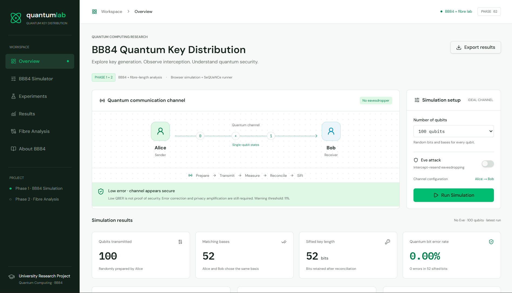
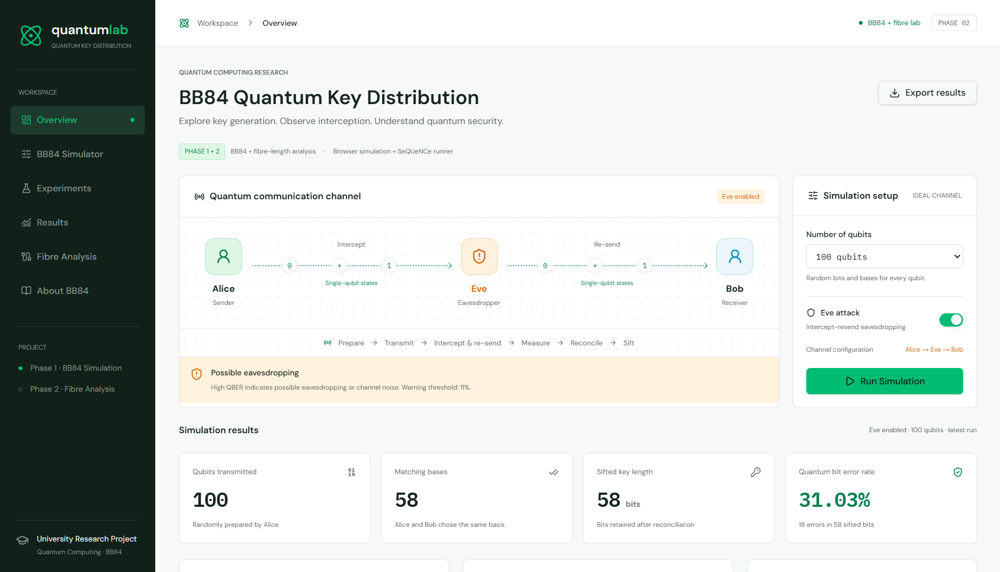
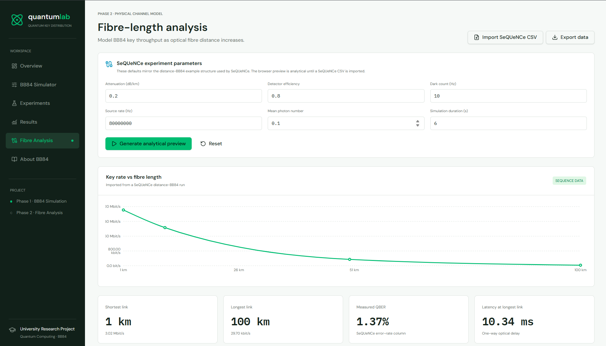
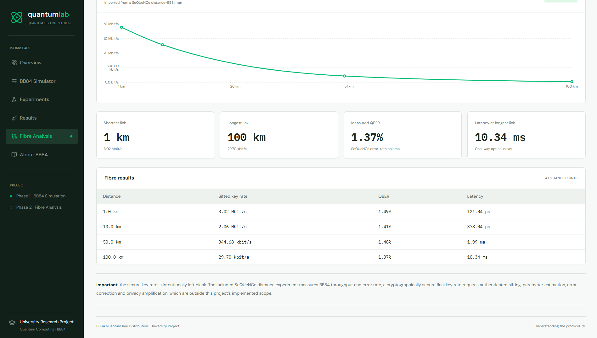

<div align="center">

# 🔐 BB84 Quantum Key Distribution

### Simulating Secure Quantum Communication with Intercept-Resend Eavesdropping

<p>
  
  
  
  
</p>

<p>
  
  
  
</p>

**A complete interactive simulation and experimental analysis platform for the BB84 Quantum Key Distribution protocol.**

[Features](#-key-features) •
[Architecture](#-architecture) •
[SeQUeNCe Experiment](#-sequeence-fibre-experiment) •
[Results](#-experimental-results) •
[Setup](#-getting-started)

</div>

---

## 📌 Project Overview

This project implements and visualizes the **BB84 Quantum Key Distribution (QKD)** protocol and demonstrates how an **Intercept-Resend eavesdropping attack** affects quantum communication.

The platform combines:

- An interactive BB84 simulator
- Alice and Bob basis selection
- Quantum bit transmission
- Sifting and key generation
- Intercept-resend Eve simulation
- QBER calculation
- Statistical comparison across multiple trials
- Quantum-state visualization
- Fibre-length analysis
- Real **SeQUeNCe** quantum network simulation
- CSV-based experimental result import
- Interactive throughput and latency analysis

The goal is to demonstrate both the **theoretical security properties of BB84** and the practical effect of increasing optical-fibre distance on quantum communication performance.

---

# 🎯 Why I Built This

Quantum Key Distribution is one of the most important applications of quantum computing because it provides a fundamentally different approach to secure communication.

Instead of relying only on computationally difficult mathematical problems, BB84 uses the properties of quantum measurement.

This project was built to answer three practical questions:

1. **How does BB84 generate a shared secret key?**
2. **How can an eavesdropper be detected?**
3. **How does communication distance affect QKD performance?**

The project therefore combines an educational simulator with a real quantum-network simulation experiment using **SeQUeNCe**.

---

# 🖥️ Application Screenshots

## 1. BB84 Simulation — No Eavesdropper

The simulator allows Alice and Bob to generate random bits and bases, perform quantum transmission, and calculate the resulting sifted key and QBER.



---

## 2. Intercept-Resend Attack

Eve intercepts Alice's qubits, measures them using randomly selected bases, and resends the resulting states to Bob.



The introduction of Eve creates detectable errors in the sifted key, increasing the **Quantum Bit Error Rate (QBER)**.

---

## 3. Fibre-Length Analysis

The application provides an interactive analysis page for studying the relationship between fibre distance and BB84 throughput.



The application supports both:

- Analytical preview data
- Real SeQUeNCe experimental measurements

---

## 4. SeQUeNCe Experimental Results

Real measurements generated using the SeQUeNCe quantum network simulator can be imported into the application through CSV.



---

# 🔬 What is BB84?

**BB84** is a Quantum Key Distribution protocol introduced by Charles Bennett and Gilles Brassard in 1984.

The protocol allows two parties:

- **Alice** — sender
- **Bob** — receiver

to establish a shared secret key over a quantum communication channel.

A potential attacker:

- **Eve** — eavesdropper

can attempt to intercept the quantum states.

However, because quantum states cannot generally be measured without disturbing them, Eve's presence introduces detectable errors.

---

# 🔄 BB84 Protocol Workflow

```text
                 Quantum Channel
                     
 Alice ───────────────────────────────► Bob
   │                                      │
   │                                      │
   │              Eve                    │
   │               │                      │
   │               ▼                      │
   └──────────► Intercept ───────────────┘
               Measure
               Resend
```

### Step 1 — Alice generates random bits

Example:

```text
Bits:
1 0 1 1 0 0 1 0
```

### Step 2 — Alice randomly chooses measurement bases

BB84 uses two bases:

```text
Rectilinear (+)
Diagonal (×)
```

### Step 3 — Alice encodes each bit

Each bit is encoded as a quantum state according to the selected basis.

### Step 4 — Bob randomly chooses bases

Bob does not know which basis Alice used.

### Step 5 — Sifting

Alice and Bob publicly compare their basis choices.

They keep only positions where their bases match.

```text
Alice:  +  ×  +  +  ×  ×
Bob:    +  +  +  ×  ×  ×
         ✓     ✓        ✓

Keep matching positions
```

### Step 6 — QBER calculation

Alice and Bob compare a portion of their sifted bits to estimate the error rate.

The Quantum Bit Error Rate is:

```text
QBER = Number of mismatched bits
       ─────────────────────────── × 100
       Total compared bits
```

A low QBER suggests a clean communication channel.

A significantly higher QBER can indicate noise or eavesdropping.

---

# 🕵️ Intercept-Resend Attack

The project implements a classic **Intercept-Resend attack**.

Eve performs the following:

```text
Alice
  │
  │ Quantum State
  ▼
 Eve
  │
  ├── Measure using random basis
  │
  ├── Prepare new quantum state
  │
  ▼
 Bob
```

Because Eve does not know Alice's basis, she will sometimes measure a qubit using the wrong basis.

That measurement changes the quantum state.

When Bob later measures the state, the disturbance can appear as an error.

---

# 📊 QBER and Eavesdropping

The most important indicator in this project is **QBER**.

### Without Eve

Ideally:

```text
QBER ≈ 0%
```

Example simulation:

```text
Qubits       : 100
Matching     : 50
Sifted Key   : 50
Errors       : 0
QBER         : 0.00%
```

### With Eve

The intercept-resend attack introduces errors.

Example simulation:

```text
Qubits       : 100
Matching     : 35
Sifted Key   : 35
Errors       : 6
QBER         : 17.14%
```

This demonstrates the central security principle of BB84:

> An eavesdropper attempting to obtain information from the quantum channel can introduce detectable disturbances.

---

# ⚙️ Key Features

## 🔐 BB84 Simulator

- Random bit generation
- Random basis selection
- Alice → Bob quantum transmission
- Basis reconciliation
- Sifted-key generation
- QBER calculation
- Error detection

## 🕵️ Eve Simulation

- Intercept-resend attack
- Random basis measurement by Eve
- Quantum-state disturbance
- Alice → Eve → Bob visualization
- QBER comparison

## 📈 Statistical Analysis

The simulator supports repeated trials to observe the statistical behavior of BB84.

Features include:

- Multi-trial simulation
- Average QBER
- Error distribution
- No-Eve vs Eve comparison
- QBER graphs

---

# 🧪 Statistical Comparison

Instead of relying on a single simulation, the application can perform multiple BB84 trials.

This helps demonstrate that the effect of an intercept-resend attacker is not simply a result of one random experiment.

Repeated experiments allow the user to observe the statistical difference between:

```text
No Eve
   ↓
Very low error rate

       vs.

Intercept-Resend Eve
   ↓
Higher QBER
```

---

# 🌐 Fibre-Length Analysis

The project also investigates how **optical-fibre distance** affects QKD communication.

The application provides:

- Fibre length input
- Throughput calculation
- QBER visualization
- Latency analysis
- Distance vs throughput graphs
- Experimental CSV import
- Analytical preview mode

The general relationship observed is:

```text
Fibre Distance ↑
       │
       ├── Optical loss ↑
       ├── Transmission delay ↑
       └── Effective throughput ↓
```

---

# 🚀 SeQUeNCe Fibre Experiment

The project uses **SeQUeNCe**, a quantum network simulator, to perform a fibre-distance experiment.

The experiment evaluates BB84 performance at:

```text
1 km
10 km
50 km
100 km
```

The simulation was executed using:

```bash
python sequence_distance_bb84.py --quick
```

The generated experimental data is stored in:

```text
sequence_experiment/results/distance_bb84.csv
```

Metadata is stored in:

```text
sequence_experiment/results/distance_bb84_metadata.json
```

---

# 📊 Experimental Results

The following results were obtained from the SeQUeNCe simulation:

| Fibre Distance | Throughput | QBER | Latency |
|---:|---:|---:|---:|
| 1 km | 3.018 Mbps | 1.49% | 121.04 µs |
| 10 km | 2.064 Mbps | 1.41% | 378.04 µs |
| 50 km | 344.68 kbps | 1.48% | 1.986 ms |
| 100 km | 29.70 kbps | 1.37% | 10.34 ms |

### Key Observation

The experimental data shows a strong reduction in throughput as fibre distance increases.

```text
Distance ↑
     │
     ▼
Throughput ↓
```

For example:

```text
1 km    → 3.018 Mbps
10 km   → 2.064 Mbps
50 km   → 344.68 kbps
100 km  → 29.70 kbps
```

At the same time, measured latency increases substantially with distance.

---

# 📉 Throughput Trend

The SeQUeNCe results demonstrate the following overall trend:

```text
Throughput
   │
3M │ ●
   │
2M │    ●
   │
1M │
   │
   │
   │          ●
   │
   │                  ●
   └──────────────────────────►
       1    10    50    100
              Distance (km)
```

The experiment therefore provides a practical demonstration of the trade-off between **communication distance and QKD performance**.

---

# ⚛️ SeQUeNCe Simulation Parameters

The experiment used the following configuration:

| Parameter | Value |
|---|---:|
| Simulation Duration | 0.02 s per distance |
| Fibre Attenuation | 0.2 dB/km |
| Polarization Fidelity | 0.97 |
| Source Rate | 80 MHz |
| Mean Photon Number | 0.1 |
| Detector Efficiency | 0.8 |
| Dark Count | 10 |
| Random Seed | 2026 |
| Distances | 1, 10, 50, 100 km |

These parameters are recorded in:

```text
sequence_experiment/results/distance_bb84_metadata.json
```

---

# 🧮 Analytical Preview vs SeQUeNCe Data

The application supports two types of fibre analysis.

### Analytical Preview

Used when no experimental CSV has been imported.

It provides a theoretical/analytical visualization of expected throughput behavior.

### SeQUeNCe Data

Once the generated CSV is imported, the application switches to real simulation measurements.

```text
PREVIEW
   ↓
Import CSV
   ↓
SEQUENCE DATA
   ↓
Experimental graph + table
```

This makes it possible to compare a conceptual model with actual quantum-network simulation results.

---

# 🏗️ Architecture

```text
                         ┌──────────────────────┐
                         │      React UI        │
                         │   TypeScript + Vite  │
                         └──────────┬───────────┘
                                    │
                  ┌─────────────────┼─────────────────┐
                  │                 │                 │
                  ▼                 ▼                 ▼
          ┌──────────────┐  ┌──────────────┐  ┌──────────────┐
          │ BB84 Engine  │  │ Eve Attack   │  │ Fibre        │
          │              │  │              │  │ Analysis     │
          └──────┬───────┘  └──────┬───────┘  └──────┬───────┘
                 │                 │                 │
                 └─────────────────┼─────────────────┘
                                   │
                                   ▼
                         ┌──────────────────────┐
                         │   Results / Charts   │
                         │ QBER / Key / Rate    │
                         └──────────────────────┘

                                   ▲
                                   │ CSV
                                   │
                         ┌──────────────────────┐
                         │     SeQUeNCe         │
                         │ Quantum Network Sim  │
                         └──────────────────────┘
```

---

# 📁 Project Structure

```text
BB84-Quantum-Key-Distribution/
│
├── public/
│
├── src/
│   ├── components/
│   ├── pages/
│   ├── hooks/
│   ├── lib/
│   └── ...
│
├── sequence_experiment/
│   ├── sequence_distance_bb84.py
│   └── results/
│       ├── distance_bb84.csv
│       └── distance_bb84_metadata.json
│
├── docs/
│   ├── screenshots/
│   │   ├── overview.png
│   │   ├── eve-attack.png
│   │   ├── fibre-analysis.png
│   │   └── fibre-results.png
│   │
│   ├── DEMO_SCRIPT.md
│   ├── IEEE_PAPER_DRAFT.md
│   ├── PPT_OUTLINE.md
│   └── PROJECT_COMPLETION.md
│
├── package.json
├── vite.config.ts
├── tsconfig.json
└── README.md
```

---

# 🛠️ Tech Stack

### Frontend

- React
- TypeScript
- Vite
- Tailwind CSS
- Recharts

### Quantum Computing

- BB84 Quantum Key Distribution
- Intercept-Resend Eavesdropping
- QBER Analysis
- SeQUeNCe Quantum Network Simulator

### Experimentation

- Python
- CSV-based result processing
- Fibre-distance simulation
- Throughput analysis
- Latency measurement

### Development

- Git
- GitHub
- Node.js
- npm

---

# ✨ Core Application Modules

## Dashboard

Provides an overview of the project and the major quantum communication concepts.

## BB84 Simulator

Allows users to configure and execute BB84 experiments.

Supported qubit counts include:

```text
10
50
100
500
1000
```

## Eve Attack Mode

Enables or disables the intercept-resend attacker.

```text
No Eve:
Alice ───────────► Bob

Eve:
Alice ─────► Eve ─────► Bob
```

## QBER Analysis

Calculates the percentage of mismatched bits after basis reconciliation.

## Protocol Visualization

Provides a visual representation of:

```text
Alice
  ↓
Quantum Channel
  ↓
Eve (optional)
  ↓
Bob
  ↓
Sifting
  ↓
QBER
  ↓
Shared Key
```

## Quantum State Visualization

Provides visual educational representations of quantum states and basis selection.

## Fibre Analysis

Allows users to analyze throughput and latency as fibre distance increases.

## CSV Import

Real SeQUeNCe results can be imported directly into the web application.

---

# 🧪 Testing and Validation

The project was validated using controlled experiments.

### Test 1 — BB84 Without Eve

```text
Qubits       : 100
Matching     : 50
Sifted Key   : 50
Errors       : 0
QBER         : 0.00%
```

Expected behavior:

```text
No eavesdropper
      ↓
No induced interception errors
      ↓
QBER ≈ 0%
```

### Test 2 — BB84 With Eve

```text
Qubits       : 100
Matching     : 35
Sifted Key   : 35
Errors       : 6
QBER         : 17.14%
```

Expected behavior:

```text
Intercept-Resend Attack
          ↓
Quantum disturbance
          ↓
Higher QBER
```

### Test 3 — Fibre Distance

SeQUeNCe was used to test:

```text
1 km → 10 km → 50 km → 100 km
```

The experiment showed decreasing throughput and increasing latency as the fibre distance increased.

---

# ⚠️ Scientific Scope and Limitations

This project is primarily an **educational and experimental simulation platform**.

The reported SeQUeNCe throughput values represent simulated BB84 communication performance.

They should **not** be interpreted as guaranteed cryptographic final-key rates.

A complete production-grade QKD system would require additional stages such as:

- Error correction
- Information reconciliation
- Privacy amplification
- Authentication
- Security parameter estimation
- Finite-key analysis
- More detailed physical-device modelling

The project focuses specifically on demonstrating the BB84 protocol, eavesdropping detection, QBER behavior, and fibre-distance performance.

---

# 🚧 Challenges & Solutions

## Challenge 1 — Visualizing Quantum Concepts

Quantum states are difficult to understand through raw numerical output.

### Solution

The application provides:

- Protocol diagrams
- Quantum-state visualizations
- Step-by-step qubit inspection
- Alice/Bob basis visualization
- Eve attack visualization

---

## Challenge 2 — Demonstrating Eavesdropping

A single BB84 run can produce random results.

### Solution

The application supports repeated statistical trials and compares QBER distributions between:

```text
No Eve
vs
Intercept-Resend Eve
```

---

## Challenge 3 — Fibre Distance Simulation

The goal required evaluating how communication performance changes with distance.

### Solution

A dedicated SeQUeNCe experiment was created to measure:

- Throughput
- Error rate
- Latency

at multiple fibre distances.

---

## Challenge 4 — Connecting Simulation and Visualization

The SeQUeNCe experiment runs independently from the React interface.

### Solution

Experimental results are exported to CSV and imported into the web application.

```text
SeQUeNCe
   ↓
CSV
   ↓
React Application
   ↓
Interactive Charts
```

---

# 🚀 Getting Started

## Prerequisites

Install:

- Node.js
- npm
- Python 3.13+
- Git

---

## 1. Clone the Repository

```bash
git clone https://github.com/Tharunnxx/BB84-Quantum-Key-Distribution.git
cd BB84-Quantum-Key-Distribution
```

---

## 2. Install Frontend Dependencies

```bash
npm install --legacy-peer-deps
```

---

## 3. Start the Development Server

```bash
npm run dev
```

The application will be available at:

```text
http://localhost:8080/
```

---

# ⚛️ Running the SeQUeNCe Experiment

Install SeQUeNCe:

```bash
pip install sequence
```

Verify the installation:

```bash
pip show sequence
```

Then run:

```bash
python sequence_experiment/sequence_distance_bb84.py --quick
```

The experiment generates:

```text
sequence_experiment/results/distance_bb84.csv
```

and:

```text
sequence_experiment/results/distance_bb84_metadata.json
```

---

# 📥 Importing SeQUeNCe Results

After running the experiment:

1. Open the application.
2. Navigate to **Fibre Analysis**.
3. Import:

```text
distance_bb84.csv
```

4. The application will display:

- Fibre distance
- Throughput
- Error rate
- Latency
- Experimental graph
- Results table

The page changes from:

```text
PREVIEW
```

to:

```text
SEQUENCE DATA
```

when real experimental measurements are loaded.

---

# 📤 CSV Format

The generated CSV follows this structure:

```csv
Distance_km,Distance_m,Throughput_bits_per_second,Error_rate,Latency_ns
1,1000.0,3018048.3543623425,0.014871162280701754,121039.99699999999
10,10000.0,2063761.2768342057,0.014132165605095542,378039.996
50,50000.0,344677.92681962234,0.01484375,1986039.9769999997
100,100000.0,29695.0805138512,0.013671875,10340039.755
```

This format allows the frontend to remain independent from the Python simulation.

---

# 🔮 Future Enhancements

Potential improvements include:

- Error correction simulation
- Privacy amplification
- Final secret-key rate calculation
- Decoy-state BB84
- More realistic detector noise
- Multi-node quantum networks
- Quantum repeaters
- Different fibre attenuation models
- Larger distance sweeps
- Additional QKD protocols such as E91
- Real quantum hardware integration
- Automated experiment comparison
- Advanced security analysis

---

# 📚 Academic Context

This project was developed as an academic **Quantum Computing / Quantum Communication** project.

### Project Topic

**BB84 Quantum Key Distribution with Intercept-Resend Eavesdropping**

### Experimental Requirement

> Simulate BB84 with and without an intercept-resend attacker, then model key rate vs fibre length in SeQUeNCe.

### Main Concepts Demonstrated

- Quantum superposition
- Quantum measurement
- BB84 protocol
- Basis reconciliation
- Quantum key distribution
- Eavesdropping
- Intercept-resend attack
- QBER
- Quantum network simulation
- Fibre attenuation
- Communication latency
- Throughput analysis

---

# 📖 References

- Bennett, C. H., & Brassard, G. — *Quantum Cryptography: Public Key Distribution and Coin Tossing*, 1984.
- SeQUeNCe — Quantum Network Simulation Framework.
- BB84 Quantum Key Distribution literature and quantum communication research.

---

# 💼 Resume Highlights

This project can be summarized on a resume as:

> **BB84 Quantum Key Distribution Simulator** — Built an interactive React/TypeScript platform implementing BB84 QKD with intercept-resend eavesdropping, QBER analysis, statistical simulations, quantum-state visualization, and SeQUeNCe-based fibre-distance experiments; evaluated throughput, error rate, and latency across 1–100 km.

### Technologies

```text
React • TypeScript • Python • SeQUeNCe
Quantum Computing • QKD • BB84 • QBER
Data Visualization • Simulation • Git/GitHub
```

---

# 👨‍💻 Author

<div align="center">

### Tharun C.

**B.Tech — Artificial Intelligence & Machine Learning**

Dayananda Sagar University  
Bengaluru, Karnataka, India

<br>

<a href="https://github.com/Tharunnxx">
  
</a>

<a href="https://tharun-c-portfolio.vercel.app/">
  
</a>

</div>

---

<div align="center">

### 🔐 Quantum Communication • Secure Key Distribution • Quantum Networks

**Built to understand how quantum mechanics can transform secure communication.**

</div>
